# ZMK Config for Charybdis 5-Column

## Build Gallery

<table border="0" cellspacing="8" cellpadding="0">
  <tr>
    <td width="33%" valign="top">
      <a href="assets/IMG_0403.jpg">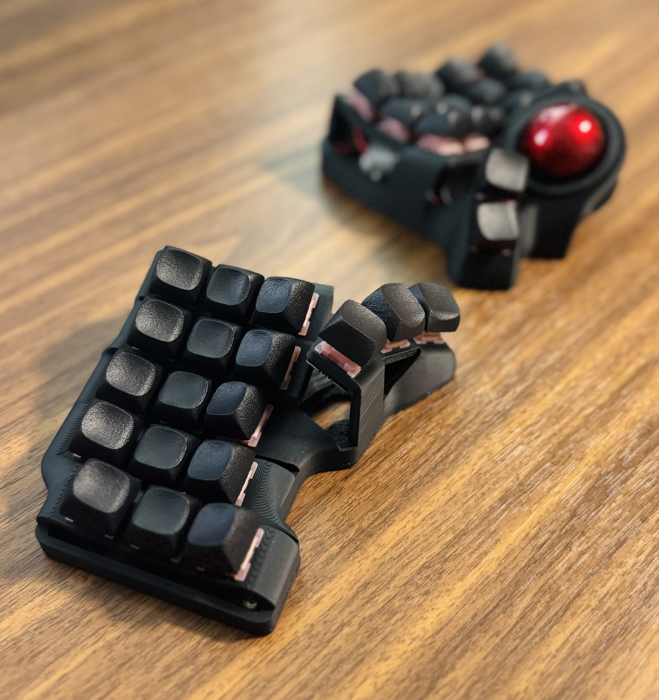</a> 
      <a href="assets/IMG_1145.jpg">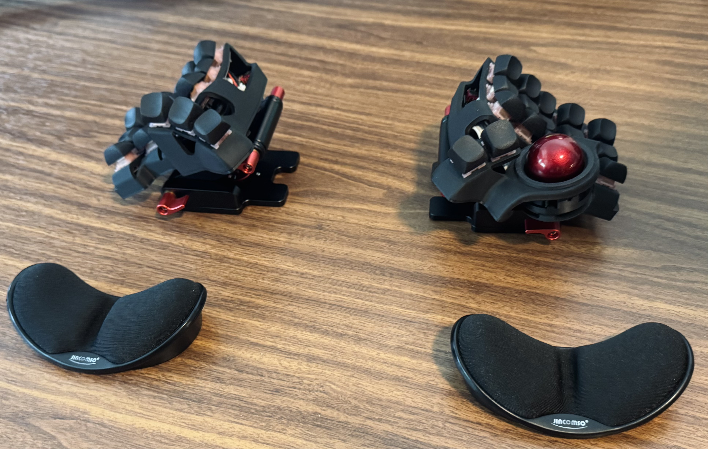</a> 
      <a href="assets/IMG_4315.jpg">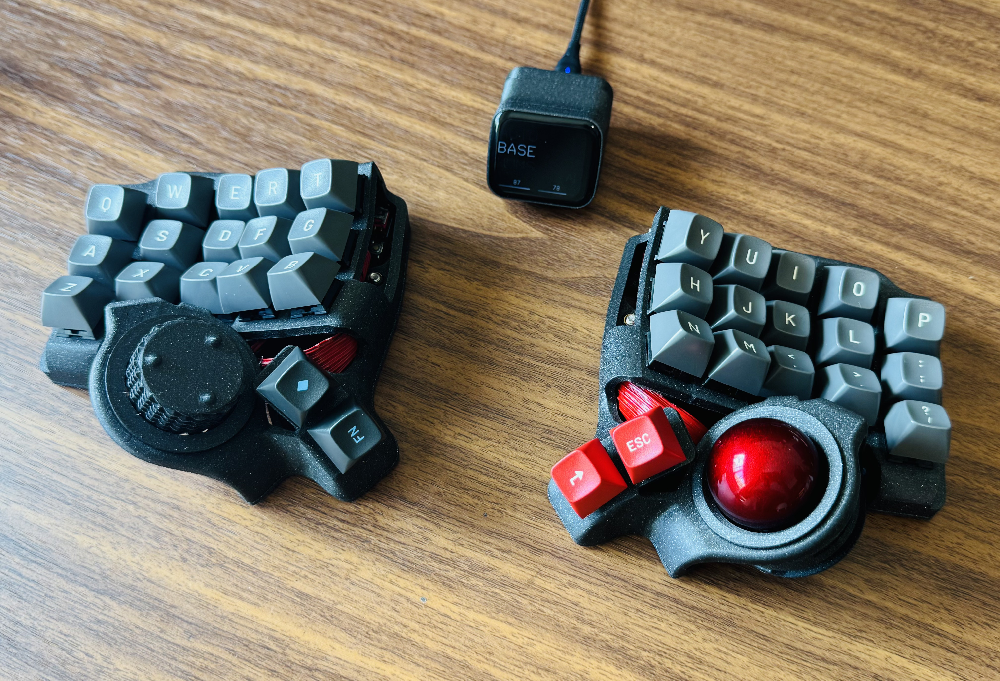</a> 
      <a href="assets/IMG_4489.jpg">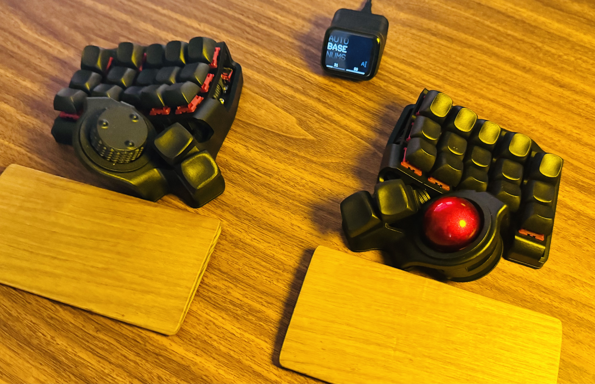</a>
    </td>
    <td width="33%" valign="top">
      <a href="assets/IMG_0404.jpg">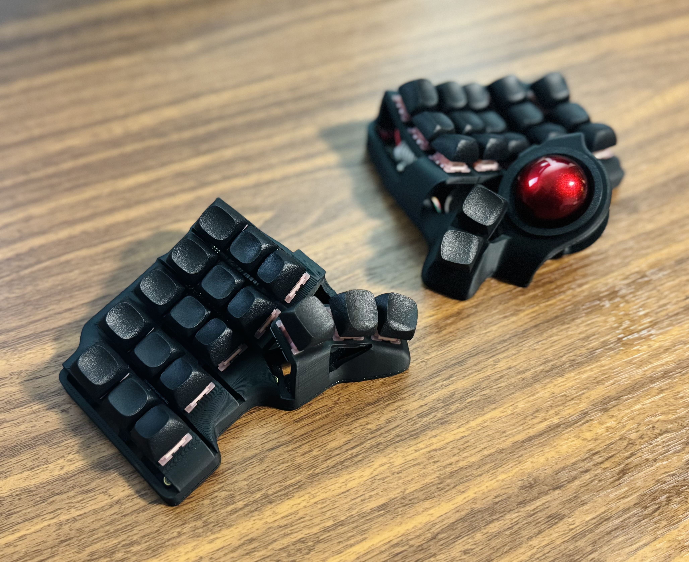</a> 
      <a href="assets/IMG_1147.jpg">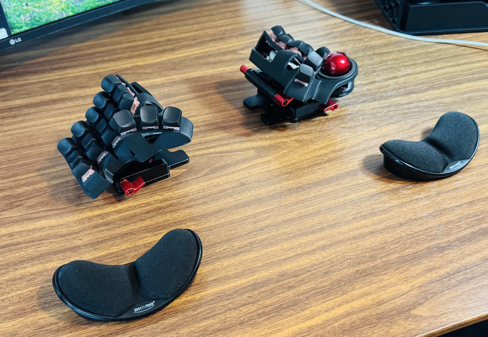</a> 
      <a href="assets/IMG_4316.jpg">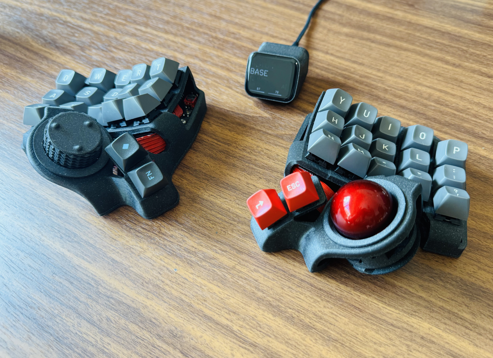</a> 
      <a href="assets/IMG_4490.jpg">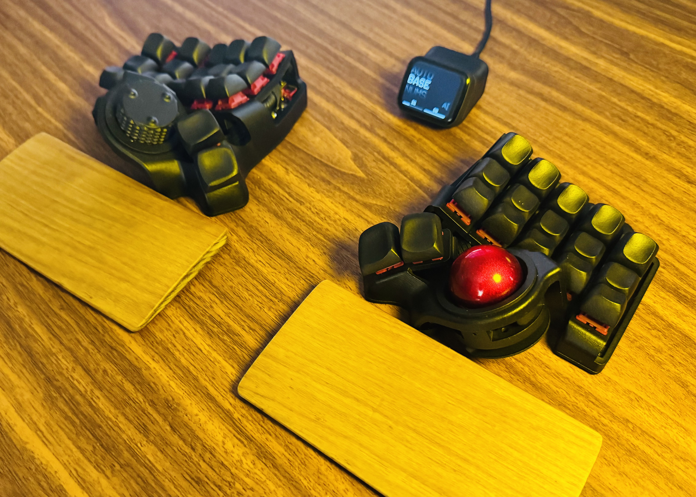</a>
    </td>
    <td width="33%" valign="top">
      <a href="assets/IMG_0405.jpg">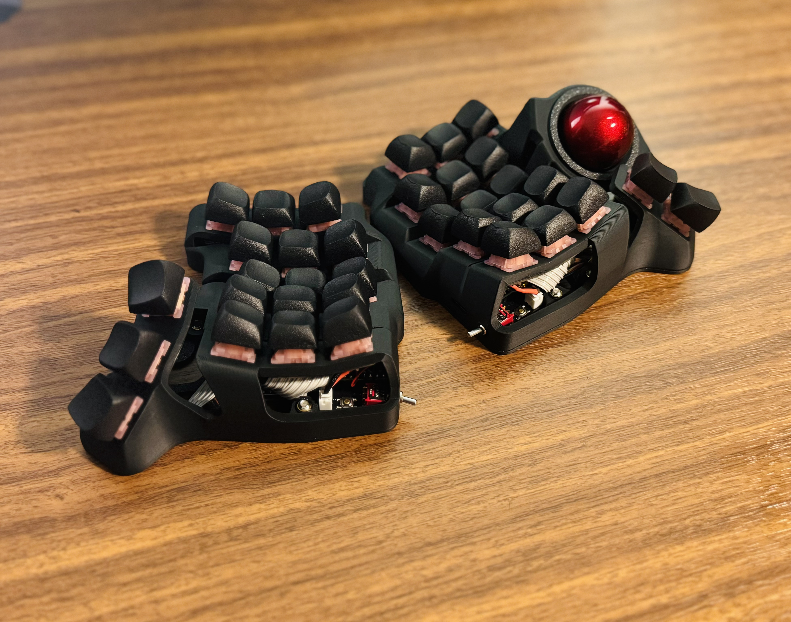</a> 
      <a href="assets/IMG_3651.jpg">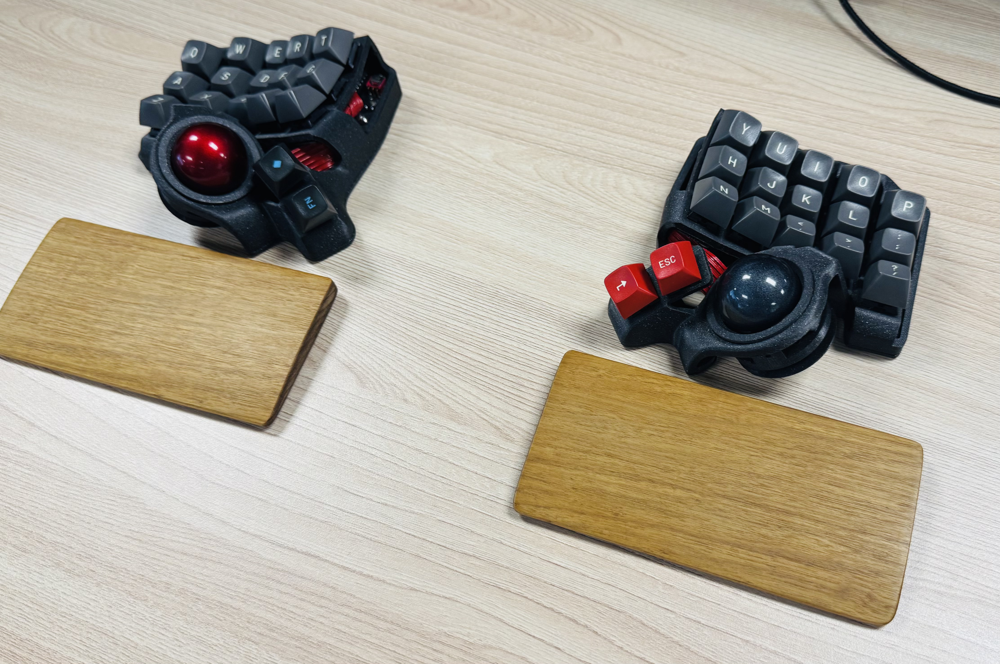</a> 
      <a href="assets/IMG_4318.jpg">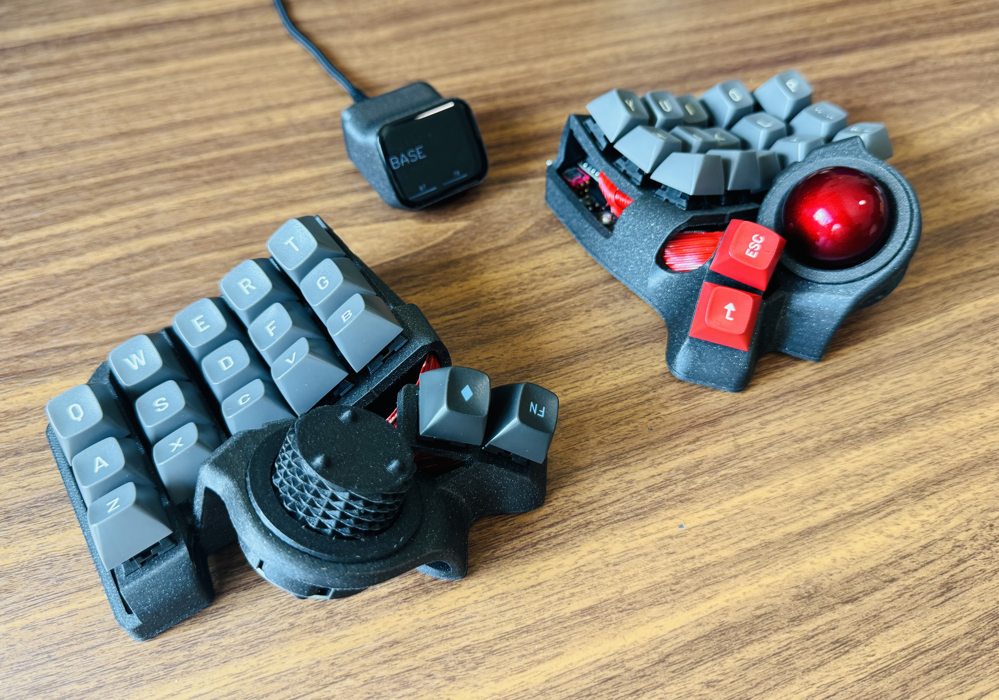</a> 
      <a href="assets/IMG_4491.jpg">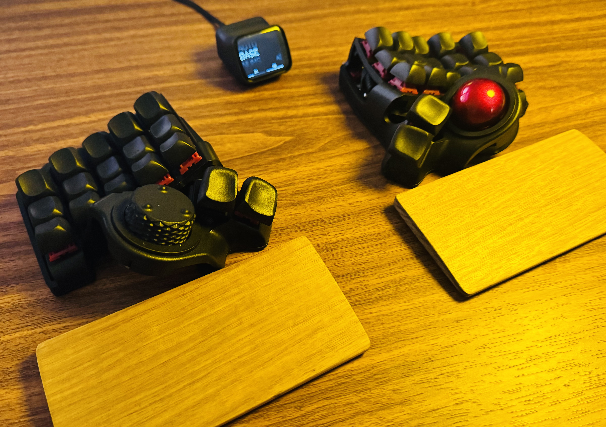</a>
    </td>
  </tr>
</table>

## Build variants

Defined in `build.yaml`; shield logic lives in `boards/shields/charybdis/`.

| Variant | Board | Purpose |
|---------|-------|---------|
| `charybdis_dongle` (+ `dongle_display`) | `nice_nano//zmk` | Dongle acting as split central (no keys of its own), SH1106/SSD1306 OLED, encoder sensor, ZMK Studio enabled |
| `charybdis_dongle_prospector` (+ `prospector_adapter`) | `xiao_ble/nrf52840/zmk` | Same dongle role on a Prospector-style display module (operator screen, fixed brightness, no ambient light sensor), ZMK Studio enabled |
| `charybdis_left` | `nice_nano//zmk` | Left half, peripheral of the dongle |
| `charybdis_right` | `nice_nano//zmk` | Right half with PMW3610 trackball, peripheral of the dongle |
| `charybdis_right_central` | `nice_nano//zmk` | Dongle-less mode: right half is the split central and handles the trackball locally (supports 1 peripheral) |
| `charybdis_left_encoder` | `nice_nano//zmk` | Left half with an EC11 encoder wired in through a composite kscan |
| `settings_reset` | `nice_nano//zmk`, `xiao_ble/nrf52840/zmk` | Clears stored bonds/settings; flash when re-pairing |

## Requirements

This config targets ZMK `main` as pinned in `west.yml` (not v0.3.0). Board targets
use the new HWMv2 form: `nice_nano//zmk` and `xiao_ble/nrf52840/zmk`.

## West modules and pinning

`config/west.yml` imports `zmk` (`app/west.yml`) and adds `zmk-pmw3610-driver`,
`zmk-helpers`, `zmk-dongle-display` and `prospector-zmk-module`. Every project is pinned to a
full commit SHA, with the source branch and date in a trailing comment, so builds are reproducible.

To bump a module:

1. `gh api repos/<org>/<repo>/commits/<branch> --jq .sha`
2. Replace the `revision:` SHA and update the comment.
3. Push and check that every variant in `build.yaml` still builds.

Bump `zmk` and the modules together, since the modules track ZMK `main` APIs.

## Trackball and encoder notes

- The trackball (PMW3610, `charybdis_3610.dtsi`) sits on the right half. Movement is forwarded to
  the central over `zmk,input-split` and processed by an input listener in `split_input.dtsi`
  (`right_central` uses a local listener instead).
- Layers are switched through input processors: the default scales movement 4/5, the `SNIPE`
  layer scales it to 1/3, and the `SCROLL` layer inverts Y, scales 1/7 and maps XY to scroll.
- The `scroll_encoder` behavior (`config/behaviors.dtsi`, `tap-ms = <20>`) maps encoder rotation
  to mouse scroll; it is bound through `sensor-bindings` on the layers that define it.
- `ZMK_POINTING_DEFAULT_SCRL_VAL` is 150 (`config/charybdis.keymap`).
- For a second (left) trackball, see the `INFO: uncomment for dual trackball` comments in the
  dongle and left overlays.

## BLE and TX power

- All variants run at +8 dBm TX power (`BT_CTLR_TX_PWR_PLUS_8`) on centrals and halves for a stronger split link.
- Centrals set `ZMK_SPLIT_BLE_PREF_LATENCY=4` (upstream default is 30); the central picks the
  split-link connection parameters at connect time, other split prefs use upstream defaults.
- Centrals also set `BT_PERIPHERAL_PREF_*` (6-12 interval, 0 latency), which applies to the
  host link, not the split link.
- Dongles allow 5 BT connections/pairings and keep sleep disabled. All variants use a 5 min idle
  timeout and 30 min deep-sleep timeout.

## Keymap

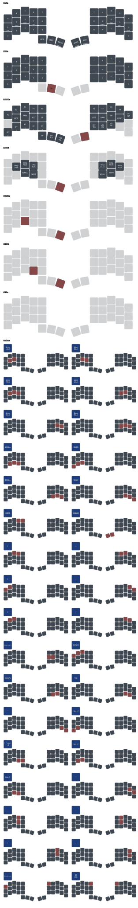
